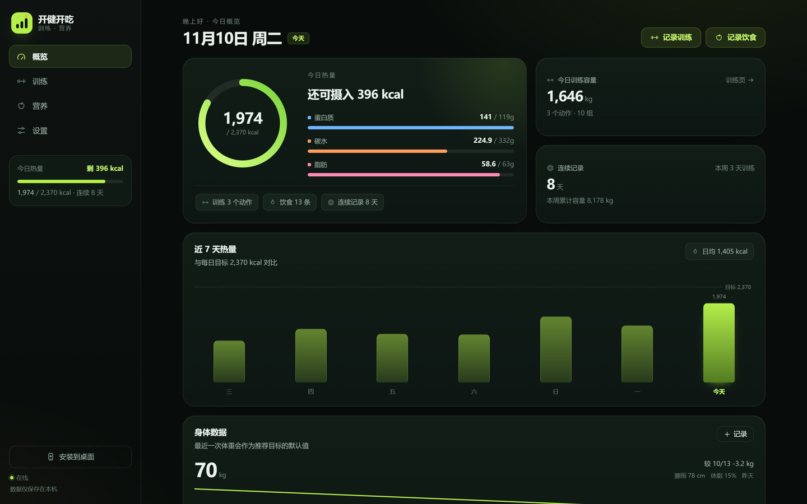
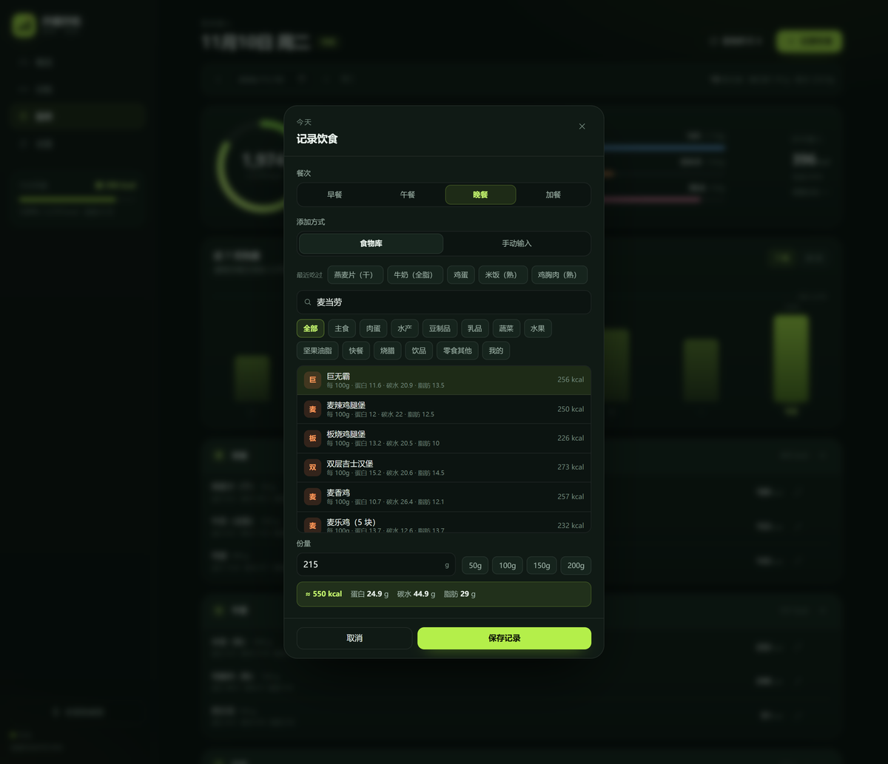
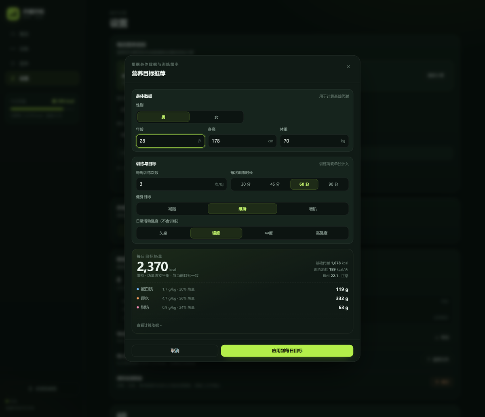

# Kaijian Kaichi · 开健开吃

**A local-first fitness & nutrition PWA. No signup. Works offline.**

Log a set of squats or a plate of char siu rice, and see how much protein you have left.  
Your data stays in your browser by default; sign in only if you want to sync across devices.

[**Live demo**](https://justanlogic.github.io/kaijian-kaichi/?demo=1) · [Install](#install) · [中文](README.md) · [Releases](../../releases)



`3-step logging` · `230 Chinese foods` · `transparent calorie targets` · `no account required`

> The app UI is currently in Chinese. An English UI is on the roadmap; the data model and food database are language-agnostic.

## Why

Most fitness apps start with a signup form. I wanted the opposite: open a link, log a meal in three steps, and keep the data on my own device.

Kaijian Kaichi combines a gym log and a food diary in one local-first PWA. It ships with 230 Chinese foods — including fast food and Cantonese roast meats — because generic food databases rarely know what char siu or a Big Mac costs in calories.

## What is different

| | Kaijian Kaichi | Typical tracker |
| --- | --- | --- |
| Start | Open the page and log, no account | Sign up, onboarding, goals |
| Data | Local by default; cloud sync optional | Cloud by default |
| Chinese food | 230 items, fast food & Cantonese roast, 114 aliases | Generic database |
| Targets | Formula is visible and auditable | A number without context |

## Features

- **Training**: exercises, sets, weight, reps, date, notes; volume and PR detection; history by day; copy last workout; reusable templates; undo delete.
- **Nutrition**: 230 foods with kcal / protein / carbs / fat per 100g; meal groups; portion math; edit entries; copy yesterday; recent foods; custom foods; 7/30-day trend.
- **Body metrics**: weight, waist, body fat; 14-point sparkline; latest weight feeds the calorie target.
- **Targets**: Mifflin-St Jeor BMR + activity factor + MET 6.0 training + goal factor; protein 1.7–2.0 g/kg, fat 0.9 g/kg, carbs by remainder; safety guards (BMI, age, training frequency).
- **App**: offline via Service Worker, installable PWA, dark/light/system themes, JSON export/import with validation and 10-second undo, optional cloud sync with per-account isolation.

## Screenshots

<p align="center">
  
  
</p>

<p align="center">
  <sub>Left: search “麦当劳” → 10 results; Big Mac 215g / 550 kcal in one tap. Right: targets for 70kg / 178cm / 3 sessions per week.</sub>
</p>

## Quick start

### Try the demo

<https://justanlogic.github.io/kaijian-kaichi/?demo=1>

The demo injects sample data (70kg / 15% body fat) and resets on refresh. It will **not** overwrite existing local records.

### Run locally

```bash
git clone https://github.com/justanlogic/kaijian-kaichi.git
cd kaijian-kaichi
python3 -m http.server 4173
# open http://127.0.0.1:4173/
```

Service Worker and installability require HTTPS (localhost is fine). The site is fully static — deploy it to GitHub Pages, Netlify, Vercel, or any object storage.

## Food data

230 items / 12 content categories + “My foods” / 114 aliases.

Highlights:

- Fast food: McDonald’s (10), KFC (6), plus noodles, rice bowls, hot pot, sandwiches.
- Cantonese roast: char siu, crispy pork belly, roast goose, roast duck, white cut chicken, soy sauce chicken, lou mei.
- Aliases: “西红柿” → tomato, “地瓜” → sweet potato, “车厘子” → cherry.

Naming rules, deduplication, and sources are documented in [docs/food-data.md](docs/food-data.md) (Chinese).

## Privacy

- Local by default: data lives in `localStorage` under `kjkc.state.v1`; nothing is uploaded unless you sign in.
- Cloud sync is optional; one JSON snapshot per account, protected by row-level security (`owner_id = auth.uid()`).
- Conflicts never overwrite silently: when both sides have records, you choose.
- Export JSON anytime; clearing data requires typing a confirmation and creates a snapshot with a 10-second undo.
- No ads, no third-party analytics, no passwords stored.

## Roadmap

- **v1.7.1**: demo mode, search-selection fix, docs
- **v1.8.0**: weekly report, CSV export, shareable summary card
- **v1.9.0**: Strong / Hevy CSV import, per-account local cache isolation
- **v2.0.0**: English UI, Hong Kong food pack, PWA Share Target

## Contributing

Issues and PRs are welcome — food corrections, regional foods, UX improvements, and documentation fixes.

- Read [CONTRIBUTING.md](CONTRIBUTING.md) first.
- For food data, use the “Food data” issue template and include the name, category, values per 100g, and source.
- Run `node scripts/check-foods.mjs` before submitting.

## License

[MIT](LICENSE) © 2026 justanlogic

---

If this saves you from installing another app, a **Star** helps.  
Missing a food you actually eat? Open an issue and I’ll prioritize it.
