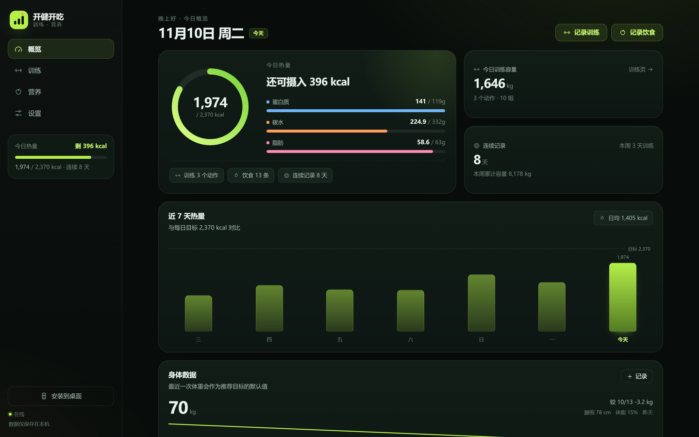
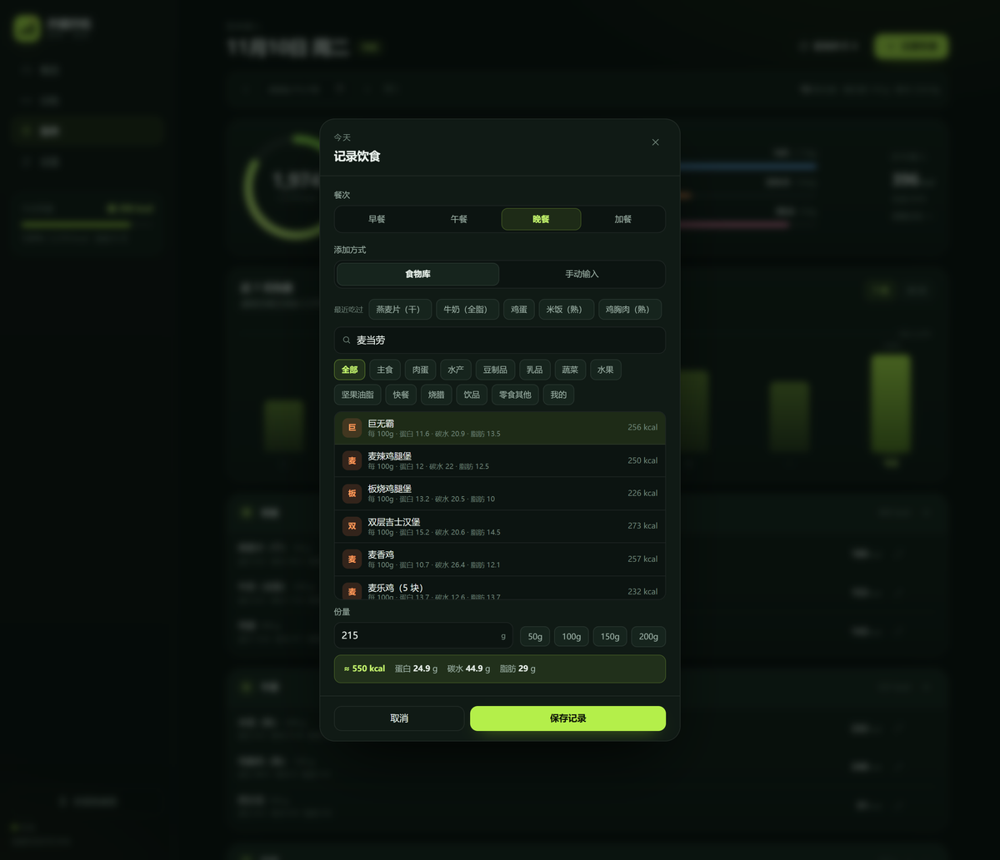
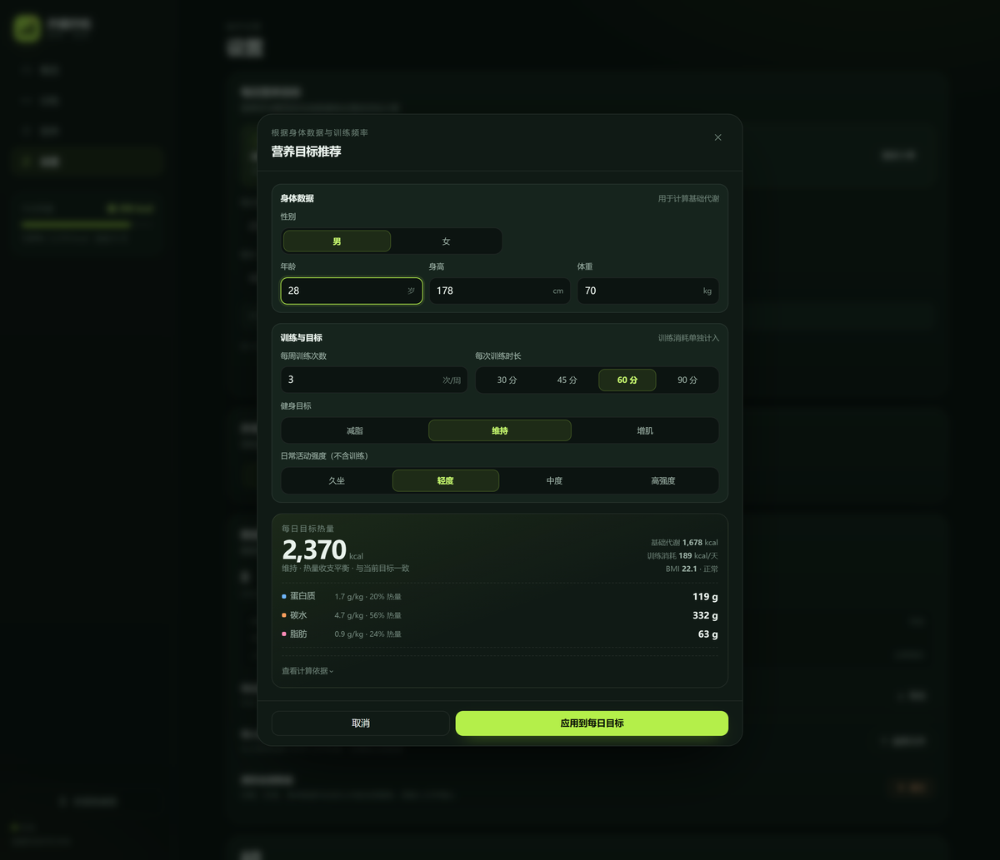
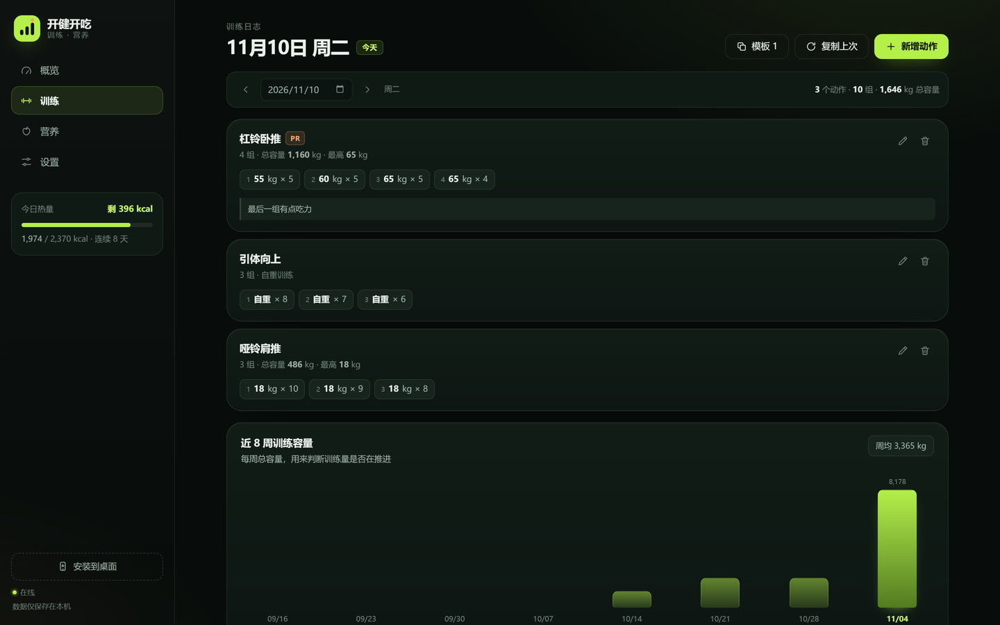
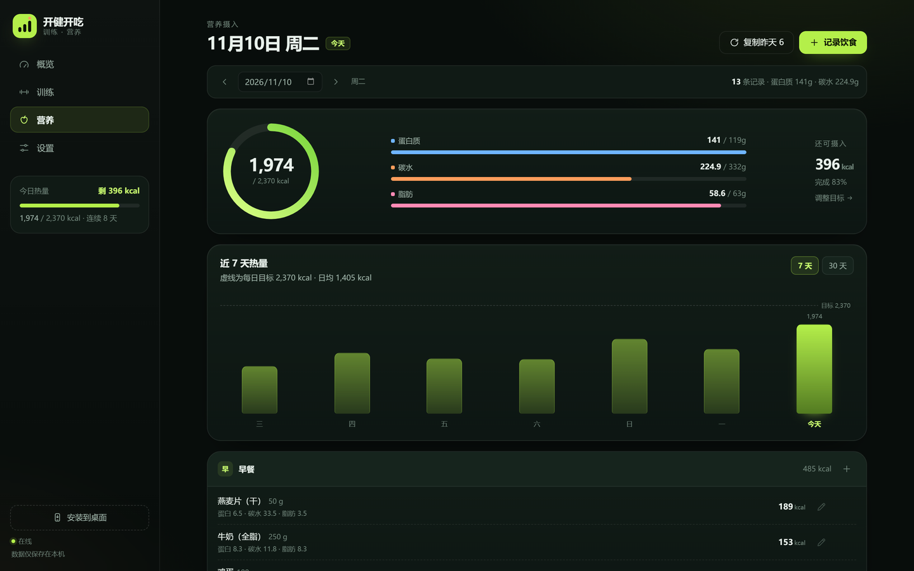
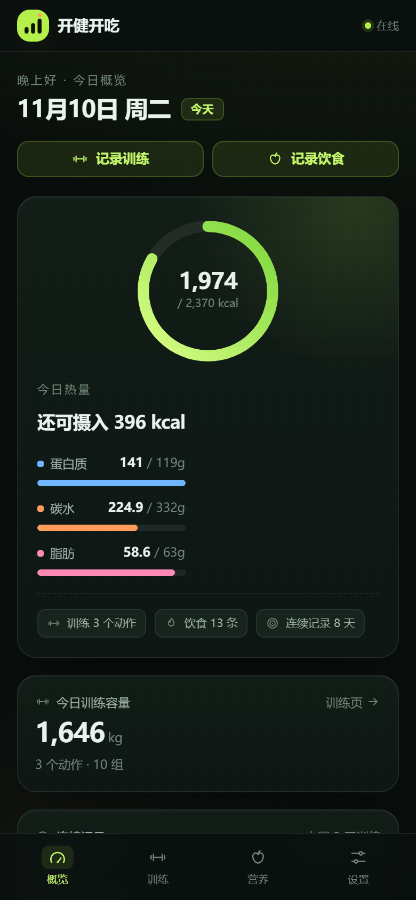

# 开健开吃 · Kaijian Kaichi

**不用注册、断网也能用的训练 + 饮食记录 PWA。**

记一组深蹲、一顿叉烧饭，看看今天还差多少蛋白质。  
数据默认只存在你的浏览器；需要跨设备时，再选择登录。

[**在线试用**](https://justanlogic.github.io/kaijian-kaichi/?demo=1) · [安装到手机](#安装到手机) · [English](README.en.md) · [更新日志](../../releases)

[](https://justanlogic.github.io/kaijian-kaichi/?demo=1)
[](LICENSE)
[](manifest.webmanifest)



`3 步记完一条` · `230 条中国食物` · `目标热量算给你看` · `无账号也能用`

---

## 为什么做这个

每次记一顿饭要跳三个 App：一个查热量，一个记饮食，一个看训练。  
我想要的只是一个**不用注册、断网也能记、搜得到叉烧和麦当劳**的地方。  
所以我把它做成了一个 PWA：打开就能记，数据默认留在本机。

## 它有什么不同

| | 开健开吃 | 常见记录工具 |
| --- | --- | --- |
| 开始使用 | 打开网页就能记，无需账号 | 先注册、填资料、选目标 |
| 数据归属 | 默认只在本机；云同步可选 | 默认上传云端 |
| 中国食物 | 230 条，含快餐、烧腊、114 条别名 | 通用库，地方食物常搜不到 |
| 目标依据 | 公式可展开，安全边界写在明面 | 多数只给一个数字 |

## 功能

### 训练

- 记录动作、每组重量与次数、日期与备注；动作支持搜索联想（44 个内置动作，也可自由输入）
- 自动计算每个动作容量（重量 × 次数）与当日合计
- 历史按日期归档，支持分页加载；刷新最重纪录时标 **PR**
- 复制上一次训练；把某天存为模板，一键填入任意日期
- 删除可撤销，误删不用重记

### 营养

- 内置 **230 条**常见食物（每 100g 热量 / 蛋白质 / 碳水 / 脂肪），含麦当劳、肯德基、广式烧腊
- 按早餐 / 午餐 / 晚餐 / 加餐分组；份量换算、实时营养预览
- 记录可编辑：食物库条目按份量重算，手动条目改数值
- 一键「复制昨天」；录入弹层提供「最近吃过」6 个快捷项
- 自定义食物存入「我的」，下次直接选
- 热量环、三大营养素进度、剩余 / 超出；7 / 30 天趋势
- 按身体数据与训练频率推荐每日目标；公式可展开，四项可手调、可恢复推荐

### 身体数据

- 体重、腰围、体脂，一天一条（同日覆盖）
- 近 14 次迷你曲线与最近 3 条历史
- 最近体重自动作为营养目标推荐的默认值

### 应用能力

- **本地优先**：数据默认写入浏览器 localStorage；不登录不会上传
- **云同步（可选）**：WorkBuddy / 微信两种登录，训练、饮食、目标跨设备同步；按账号隔离
- **离线可用**：Service Worker 预缓存应用外壳，断网仍可打开并继续记录
- **可安装**：Web App Manifest + maskable 图标，桌面 / 主屏幕安装
- **可带走**：JSON 导出 / 导入；导入前校验，导入后 10 秒可撤销
- **数据保护**：清空前快照；删除、导入、清空都可撤销
- 深色 / 浅色 / 跟随系统三档主题；桌面左栏、移动底部 tab

## 界面

<p align="center">
  
  
</p>

<p align="center">
  <sub>左：搜「麦当劳」→ 10 条结果，巨无霸 215g / 550 kcal 一键记 · 右：按 70kg / 178cm / 每周 3 练算目标</sub>
</p>

<details>
<summary>更多截图（训练 / 营养 / 手机）</summary>







</details>

## 快速开始

### 在线试用

打开 <https://justanlogic.github.io/kaijian-kaichi/?demo=1>。

演示模式会注入一份示例数据（70kg / 15% 体脂），刷新即重置；**不会覆盖你本机已有的记录**。

### 安装到手机

- **iOS Safari**：分享 → 添加到主屏幕
- **Android Chrome**：地址栏右侧菜单 → 安装应用 / 添加到主屏幕

安装后像原生 App 一样打开，断网也能用。

### 本地运行

需要通过 HTTP 访问（Service Worker 与安装能力在 `file://` 下不可用）：

```bash
git clone https://github.com/justanlogic/kaijian-kaichi.git
cd kaijian-kaichi
python3 -m http.server 4173
# 打开 http://127.0.0.1:4173/
```

或任意静态服务器：

```bash
npx serve .
```

### 部署

整站是静态文件，可直接部署到 GitHub Pages / Netlify / Vercel / 对象存储。

- 需要 HTTPS（localhost 除外）才能启用 Service Worker 与安装
- `manifest.webmanifest` 的 `start_url` 与 `scope` 使用相对路径，可部署在子目录
- 更新静态资源后，把 `sw.js` 的 `VERSION` 加一

## 食物库

230 条 / 12 个内容分类 +「我的」/ 114 条别名。

| 分类 | 数量 | 典型条目 |
| --- | --- | --- |
| 主食 | 28 | 米饭（熟）、馒头、燕麦片（干）、红薯（蒸）、水饺（猪肉） |
| 肉蛋 | 35 | 鸡胸肉（熟）、瘦牛肉、五花肉、猪肝、鸡蛋、腊肠（广式） |
| 水产 | 15 | 三文鱼、虾仁、鲈鱼、鳕鱼、生蚝、鱿鱼 |
| 豆制品 | 11 | 北豆腐、嫩豆腐、豆腐干、腐竹（干）、豆浆（无糖） |
| 乳品 | 11 | 牛奶（全脂）、脱脂牛奶、希腊酸奶（无糖）、奶酪片、乳清蛋白粉 |
| 蔬菜 | 31 | 西兰花、菠菜、番茄、卷心菜、香菇（鲜）、莲藕 |
| 水果 | 20 | 香蕉、苹果、蓝莓、牛油果、猕猴桃、榴莲 |
| 坚果油脂 | 15 | 杏仁、核桃、腰果、花生酱、橄榄油、猪油 |
| 快餐 | 26 | 巨无霸、麦辣鸡腿堡、薯条、吮指原味鸡、牛肉拉面、黄焖鸡米饭 |
| 烧腊 | 13 | 叉烧、脆皮烧肉、烧鹅、烧鸭、白切鸡、豉油鸡、卤水鹅 |
| 饮品 | 13 | 美式咖啡、拿铁、可乐、啤酒、无糖气泡水 |
| 零食其他 | 12 | 黑巧克力（85%）、蛋白棒、薯片、冰淇淋、方便面 |

**检索例子**：搜「麦当劳」10 条、搜「汉堡」6 条、搜「西红柿」→ 番茄、搜「地瓜」→ 红薯。

命名规范、去重方法与数据来源见 [docs/food-data.md](docs/food-data.md)。  
数据仅用于个人记录与趋势对比，不构成医疗或营养建议。

## 目标怎么算

1. **基础代谢 BMR**（Mifflin-St Jeor）：男 `10W + 6.25H − 5A + 5`；女 `10W + 6.25H − 5A − 161`
2. **日常消耗** = BMR × 活动系数（1.2 / 1.3 / 1.4 / 1.5）
3. **训练消耗**：MET 6.0，按每周次数均摊到每天
4. **总消耗 TDEE** = 日常消耗 + 每日训练消耗
5. **目标热量** = TDEE × 目标系数（减脂 0.85 / 维持 1.0 / 增肌 1.10），下限 `max(BMR, 男 1500 / 女 1200)`
6. **蛋白质** 1.7–2.0 g/kg；**脂肪** 0.9 g/kg（20%–35%）；**碳水** 剩余热量 ÷ 4（≥1.2 g/kg）

安全边界：BMI < 18.5 选择减脂时按维持计算；BMI ≥ 28 选择增肌、每周 0 练选择增肌、未满 18 岁时给出提示。

完整输入说明、算例与边界见 [docs/nutrition.md](docs/nutrition.md)。

## 隐私与数据

- **默认本地**：数据写入浏览器 localStorage（键 `kjkc.state.v1`）；不登录不会上传
- **云同步可选**：登录后修改约 1.6 秒自动上传；云端每个账号一行 JSON 快照，RLS 只允许本人读写
- **冲突不静默覆盖**：本机与云端都有数据时，让你选择「从云端恢复」或「上传本机」
- **可导出 / 可删除**：设置页导出 JSON；清空需输入「清空」，执行前自动快照，10 秒内可撤销
- **无第三方统计**：不接广告、不埋点、不保存密码

浏览器存储不是备份：清除站点数据、无痕模式、更换设备等情况仍可能丢失。建议每月导出一次 JSON。详见 [docs/privacy.md](docs/privacy.md)。

## Roadmap

- **v1.7.1**：演示模式、搜索默认选中修复、README 与文档
- **v1.8.0**：周报、CSV 导出、可分享的周报卡片
- **v1.9.0**：Strong / Hevy CSV 导入、账号级本机缓存隔离
- **v2.0.0**：英文界面、香港食物包、PWA Share Target

计划可能调整；有想吃的食物或想要的功能，欢迎开 Issue。

## 目录结构

```text
index.html              应用外壳
manifest.webmanifest    PWA 清单
sw.js                   离线缓存
assets/styles.css       设计系统与响应式布局
js/app.js               路由、弹层、事件、安装与离线状态
js/store.js             localStorage 读写与数据规范化
js/selectors.js         容量 / 营养合计 / 连续记录 / PR 判定
js/recommend.js         营养目标推荐公式与安全边界
js/cloud.js             云服务初始化、登录、同步
js/cloud-config.js      云服务公开配置（publishableKey，可公开下发）
js/demo.js              演示模式（?demo=1）
js/data.js              食物库、动作库、餐次
js/views/*.js           概览 / 训练 / 营养 / 设置
docs/                   架构、营养、食物数据、隐私、路线图
```

## 贡献

欢迎 Issue 和 PR：食物数据纠错、地区食物补充、交互改进、文档修正都很有价值。

- 先看 [CONTRIBUTING.md](CONTRIBUTING.md)
- 食物相关请用「食物数据」Issue 模板，附上名称、分类、每 100g 数值与来源
- 提交前跑一遍 `node scripts/check-foods.mjs`

## License

[MIT](LICENSE) © 2026 justanlogic

---

如果这个项目帮你少下一个 App，欢迎点一个 **Star** ⭐  
搜不到你常吃的食物？开个 Issue，我会优先补。
