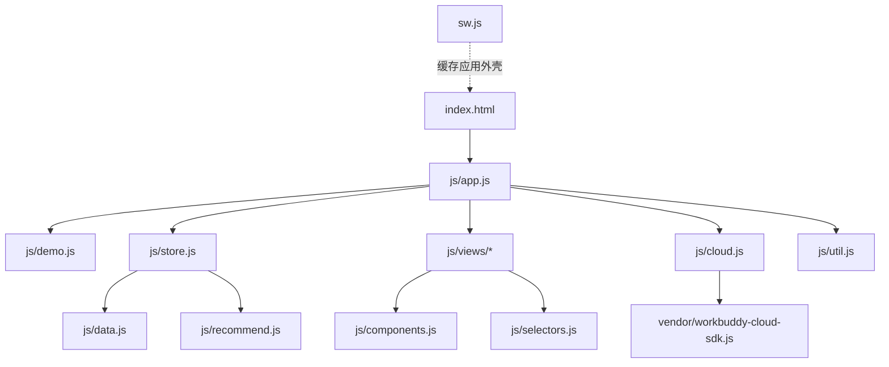

# 架构说明

开健开吃是一个**无构建步骤**的静态 PWA：原生 ES Modules + CSS 自定义属性 + localStorage + Service Worker。云端同步是可选的，不参与核心记录链路。

## 模块关系



| 模块 | 职责 |
| --- | --- |
| `js/app.js` | 路由、弹层、事件委托、安装提示、离线状态、导入导出 |
| `js/store.js` | localStorage 读写、`normalize()` 数据校验、actions、订阅 |
| `js/selectors.js` | 容量、营养合计、连续记录、PR 判定等派生数据 |
| `js/recommend.js` | 营养目标公式、输入校验、安全边界 |
| `js/views/*` | 概览 / 训练 / 营养 / 设置四个页面 |
| `js/components.js` | 热量环、营养条、柱状图、日期条等片段 |
| `js/cloud.js` | SDK 初始化、双登录、推送 / 拉取、冲突选择 |
| `js/demo.js` | `?demo=1` 示例数据、演示提示、避免覆盖真实数据 |
| `sw.js` | 网络优先 + 缓存兜底、版本桶清理 |

## 数据流

```text
用户操作 → actions.addMeal(...) → store.commit()
  → localStorage.setItem('kjkc.state.v1', JSON)
  → 通知订阅者 → app.render() → 当前 view 重绘
  → （已登录时）cloud.pushLocal() 1.6 秒防抖上传
```

- 所有写入都经过 `store.actions`，页面不直接改 localStorage。
- `commit()` 捕获渲染异常，避免一次坏数据让整页白屏。
- 读入时统一走 `normalize()`：校验 settings、goals、profile、recommendation、三个新数组（measurements / customFoods / routines），旧备份可无损加载。

## 数据结构

```js
{
  version: 1,
  createdAt: '2026-11-10T...',
  updatedAt: '2026-11-10T...',
  settings: {
    theme: 'dark' | 'light' | 'auto',
    goals: { kcal, protein, carbs, fat },
    lastMeal: 'breakfast' | 'lunch' | 'dinner' | 'snack',
    lastBackupAt: string | null,
    profile: { sex, age, height, weight, goal, sessions, duration, activity } | null,
    recommendation: { profile, result, computedAt } | null
  },
  workouts: [{ id, date, name, sets: [{ weight, reps }], note, createdAt }],
  meals: [{ id, date, meal, name, foodId, amount, portion, kcal, protein, carbs, fat, createdAt }],
  measurements: [{ id, date, weight, waist, bodyFat, note, createdAt }],
  customFoods: [{ id, name, kcal, p, c, f, amount, createdAt }],
  routines: [{ id, name, items: [{ name, sets }], createdAt }]
}
```

## 离线策略

- `sw.js` 的 fetch 为**网络优先 + 缓存兜底**：联网时取最新文件并回写缓存，断网回落。
- 导航请求命中时同时写 `./index.html`，保证直接打开任意路径也能离线。
- `VERSION` 只用于区分缓存桶；升级时清理旧桶。
- 从旧版本接管时，`app.js` 监听 `controllerchange`，无弹层、无输入焦点时自动刷新一次。
- 明确跳过 `/.cloud/` 请求，避免把 API 响应写进缓存。

## 云同步（可选）

- 表：`app_states`，一个账号一行 JSON 快照（`data jsonb`）。
- RLS：`owner_id = auth.uid()`，客户端不发送 `owner_id`。
- 策略：本机优先；一边有一边无时自动补齐；两边都有时让用户选择「从云端恢复」或「上传本机」。
- 登录后修改 1.6 秒防抖上传；离线时排队，联网重试。
- 两种登录（WorkBuddy / 微信）各自独立，数据不互通。

## 演示模式

- 入口：`?demo=1`。
- `demo.js` 在 `store.js` 之前执行，注入一份示例数据（70kg / 15% 体脂）。
- 若本机已有非演示数据，**不覆盖**，只提示「本机已有数据」。
- 演示状态带 `demo: true`，刷新会重置；「清除并退出」会移除示例数据。
- 设置页的云同步卡片在演示模式下隐藏，避免访客误登录。

## 测试

- 手工 / 自动化验收：记录、编辑、删除撤销、复制昨天、模板、导入坏备份、断网重载。
- 宽度：360 / 390 / 1024 / 1440，无横向溢出。
- 控制台 0 报错；Service Worker 更新后不出现刷新循环。
- 食物库自检：`node scripts/check-foods.mjs`。

## 已知限制

- localStorage 约 5MB，长期大量记录建议后续迁移 IndexedDB。
- 同设备切换多个账号时，本机缓存未按 owner 分桶（已列入 v1.9）。
- 可访问性未完全达标：浅色主题部分对比度约 3.06:1，部分图标按钮 30px。
- 云端删除快照暂无 UI，需要开 Issue 处理。
